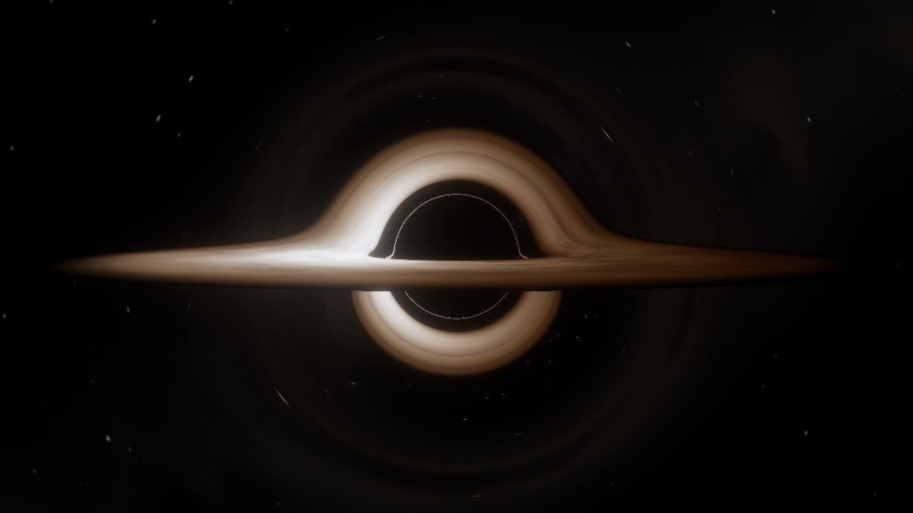
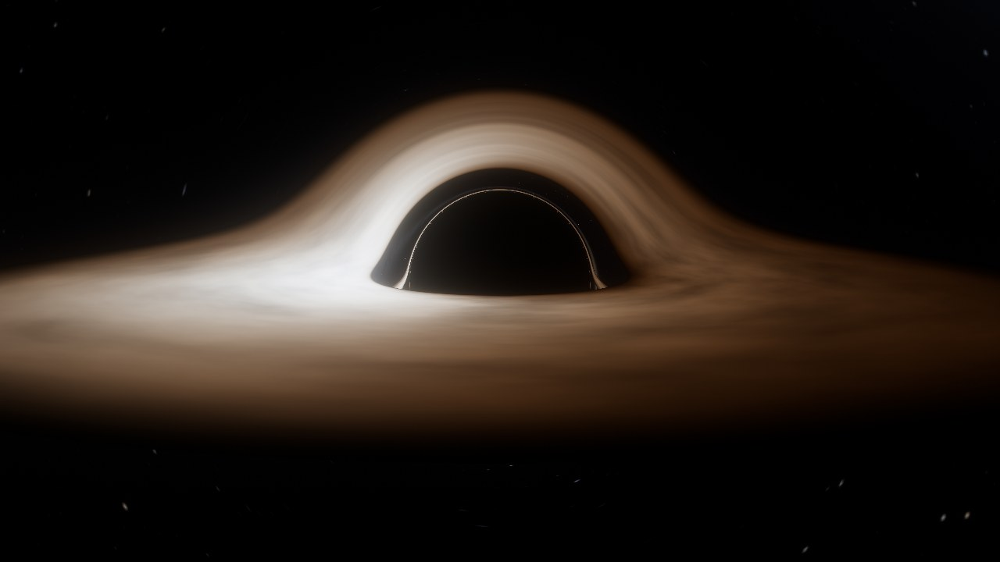
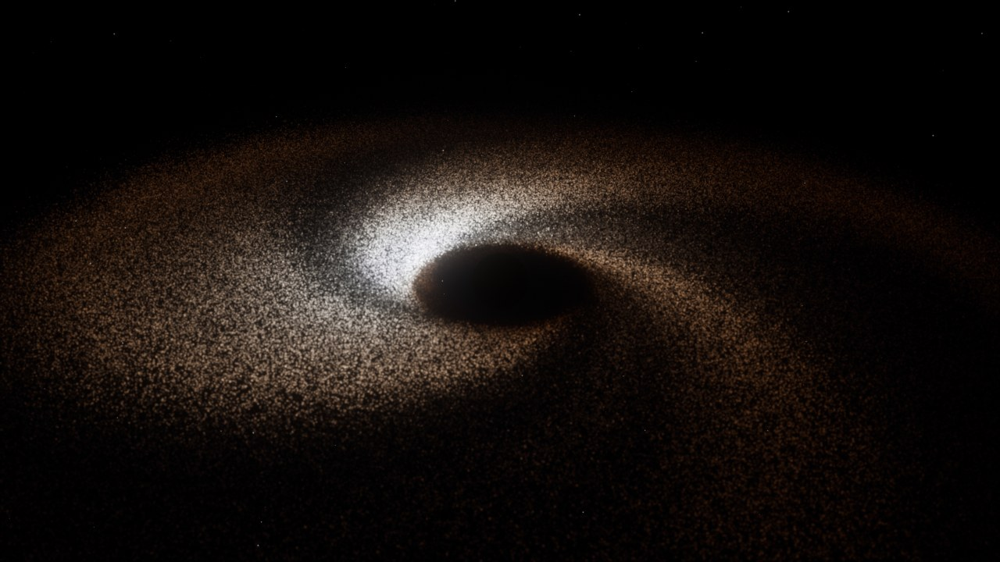
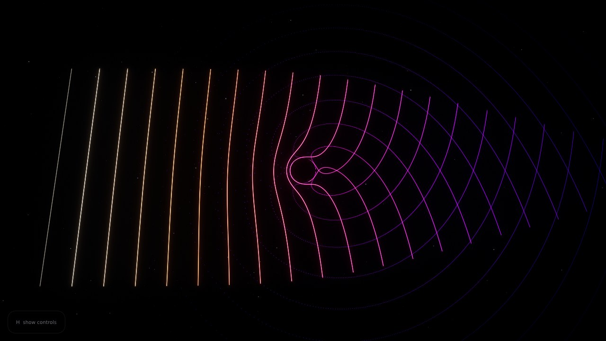
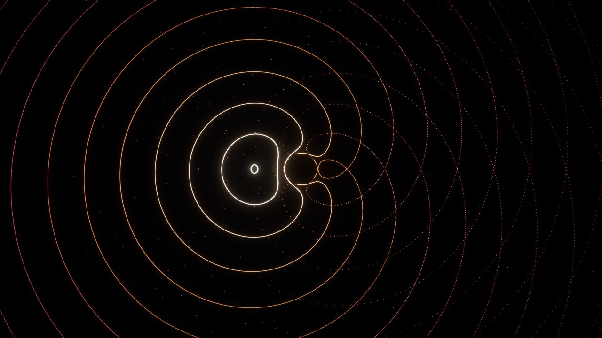
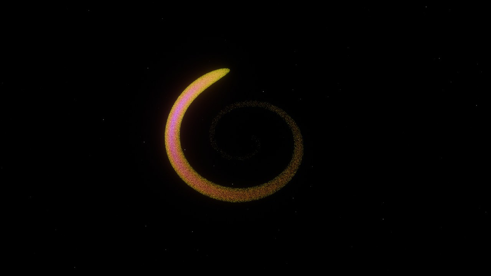
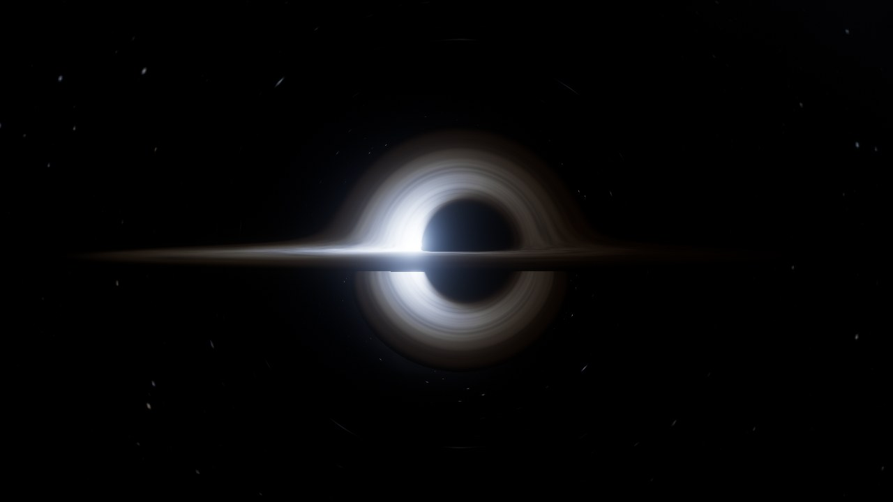

# Black Hole

Симуляция чёрной дыры в реальном времени на C++: облака частиц газа и волновые
фронты света, которые движутся по честным геодезическим метрики Шварцшильда.
Считает на видеокарте (CUDA) или на процессоре (OpenMP), переключается на лету.



| Линзирование вблизи | Аккреционный диск | Волны света вокруг тени |
|---|---|---|
|  |  |  |
| **Вспышка у дыры** | **Разрушение звезды** | **Керр, a = 0.998** |
|  |  |  |

## Что симулируется

Каждая точка — пробная частица (элемент газа или фотон), которая летит по
геодезической в пространстве-времени невращающейся чёрной дыры. Единицы
G = c = M = 1: горизонт r = 2M, фотонная сфера 3M, ISCO 6M, радиус тени 3√3 M.

**Режимы (сценарии):**

- **Accretion disk** — диск газа на почти круговых орбитах. Вязкость
  (феноменологическая, аналог α-диска) отбирает угловой момент, газ спиралью
  уходит к ISCO и падает. Новый газ подаётся на внешнем краю. Цвет «Physical»:
  чернотельный цвет при наблюдаемой температуре g·T, яркость ∝ g⁴
  (доплеровское усиление + гравитационное красное смещение).
- **Star** — приливное разрушение звезды. Модель «frozen-in»: собственная
  гравитация держит звезду целой до радиуса разрушения, дальше каждая частица
  летит свободно, и приливы растягивают звезду в поток. Связанная половина
  обломков возвращается и закручивается вокруг дыры. Цвет — слой звезды
  (ядро → поверхность).
- **Light waves** — фронты света: плоская волна (2D-срез или 3D-лист) или
  вспышка (кольцо/сфера). Фотоны одного фронта выпущены одновременно, поэтому
  в каждый момент они рисуют форму волнового фронта: видно, как он огибает
  фотонную сферу, запаздывает у дыры (задержка Шапиро) и оставляет тень
  (b < 3√3 M).

**Трассировка лучей (клавиша L).** Для каждого пикселя луч света идёт назад
от камеры по точной геодезической. Попал в горизонт — тень (радиус 3√3 M);
пересёк тонкий диск Новикова–Торна — его свет с точным красным смещением этого
луча (доплер + гравитационное); улетел — небо в асимптотическом направлении.
Отсюда задняя сторона диска над и под тенью, фотонное кольцо, кольцо Эйнштейна
и растянутые линзой звёзды. Частицы пока не линзируются (их можно наложить
поверх, «Show particles»).

**Вращающаяся дыра (Керр).** Ползунок Spin a в «Ray tracing»: при a ≠ 0 лучи
идут по гамильтоновым уравнениям в декартовых координатах Керра–Шильда
(`src/core/Kerr.hpp`, тесты сверяют ISCO и пороги захвата фотонов по и против
вращения). Тень становится несимметричной (D-форма), ISCO уходит внутрь
(1.24 M при a = 0.998), внутренний край диска раскаляется добела. Чтобы лучи не
упирались в прошлый горизонт, обратная трассировка заменена прямой в «зеркальной»
дыре со спином −a (симметрия t → −t, a → −a). Частицы пока считаются в метрике
Шварцшильда.

**Два вида времени** (переключатель Clock):
- *Observer t* — время далёкого наблюдателя. Падающий газ замедляется,
  краснеет и «застывает» у горизонта — ровно то, что увидел бы телескоп.
- *Proper τ* — собственное время частиц: газ пересекает горизонт за конечное время.

### Физика и её точность

Уравнение движения (`src/core/Schwarzschild.hpp`): геодезические Шварцшильда
плоские, поэтому в «псевдодекартовых» координатах x = r·n они сводятся **точно** к

```
d²x/dλ² = −M x / r³ · (κ + 3h²/r²),   h = |x × v|,  κ = 1 (газ) / 0 (свет)
```

Интегрирование — RK4 с адаптивным шагом (доля локального динамического
времени), в float: на игровых GPU FP64 в 32–64 раза медленнее.

Тесты (`tests/test_physics.cpp`) сверяют с аналитикой: круговая орбита,
энергия, свободное падение (циклоида), порог захвата фотона 3√3 M,
отклонение света 4M/b + 15πM²/4b², красное смещение √(1−3M/r).

Что пока **приближённо** (и будет уточнено):
- частицы рисуются прямыми лучами (линзируется только трассируемый диск и небо);
- для частиц направление на камеру для доплера берётся по прямой, а не по изогнутому лучу;
- вязкость — феноменологическая сила, а не МГД;
- профиль температуры — тонкий диск Новикова–Торна (T⁴ ∝ r⁻³(1−√(6M/r))),
  внутри ISCO — плавно гаснущее свечение;
- реальные диски горячее (10⁵–10⁷ K, бело-голубые или рентген); по умолчанию
  стоит «тёплые» 5800 K, ползунок Peak temperature позволяет поставить реальную.

## Сборка

Нужны CMake ≥ 3.21, git, компилятор C++20 (Visual Studio 2022/2026 / GCC 11+ / Clang 14+)
и OpenGL 4.3. Зависимости (GLFW, GLM, Dear ImGui) скачиваются при конфигурации,
glad и stb лежат в `third_party/`. CUDA необязательна: если CUDA Toolkit
установлен, GPU-бэкенд собирается автоматически, иначе — только CPU.

**Windows, рекомендуемый способ (с CUDA или без).** В «x64 Native Tools Command
Prompt for VS» (Пуск → набрать `x64 Native`):
```bat
cmake -S . -B build-ninja -G Ninja -DCMAKE_BUILD_TYPE=Release
cmake --build build-ninja
build-ninja\blackhole.exe
```
Ninja идёт в комплекте с Visual Studio и не требует интеграции CUDA в VS.
В строке `CUDA backend: ON/OFF` при конфигурации видно, собирается ли GPU-часть.

**Windows через генератор Visual Studio** (работает без CUDA; с CUDA нужна
установленная интеграция CUDA в вашу версию VS):
```bat
cmake -S . -B build
cmake --build build --config Release
build\Release\blackhole.exe
```

**Если с CUDA что-то не так** — соберите без неё: добавьте `-DBH_ENABLE_CUDA=OFF`.
Архитектуры GPU по умолчанию: 75, 86, 89 (RTX 20/30/40); для других карт —
`-DCMAKE_CUDA_ARCHITECTURES=...`. Проверка GPU против CPU: `ctest --test-dir build-ninja`.

**Linux:**
```bash
sudo apt install libx11-dev libxrandr-dev libxinerama-dev libxcursor-dev libxi-dev libgl-dev
cmake -S . -B build -G Ninja -DCMAKE_BUILD_TYPE=Release
cmake --build build
./build/blackhole
ctest --test-dir build --output-on-failure   # физические тесты
```

## Управление

| | |
|---|---|
| ЛКМ + тянуть | вращать камеру |
| ПКМ / СКМ + тянуть | сдвиг |
| Колесо | зум |
| Space | пауза |
| R | перезапуск сценария |
| H | спрятать/показать UI |
| P | скриншот без UI → `screenshots/` |
| F | авто-вращение камеры |
| L | линзирование (трассировка лучей); спин — в секции Ray tracing или `--spin 0.9` |
| 1 / 2 / 3 | диск / волны / звезда |

Командная строка (удобно для рендеров):

```bash
blackhole --scenario 1 --set "Source=3" --set "Flash radius=4" \
          --warmup 40 --view 0.5,0.4,50 --hide-ui --screenshot flash.png
```

`--set "Label=value"` меняет любой параметр сценария по подписи из UI.
`blackhole --help` — полный список.

## Архитектура

```
src/core/        физика: Vec3, метрики Шварцшильда и Керра, RNG — header-only, BH_HD (host+device)
src/sim/         частицы, интегратор, начальные условия, сценарии, Simulation (часы)
  scenarios/     AccretionDisk, PhotonWaves — новый режим = новый класс Scenario
src/backend/     SimBackend (интерфейс) → CpuBackend (OpenMP), CudaBackend (CUDA + GL interop)
src/render/      OpenGL 4.3: HDR, частицы-спрайты, горизонт, звёзды, bloom, ACES
  shaders/       GLSL, вшиваются в бинарник при сборке (cmake/EmbedShaders.cmake)
src/ui/          Theme (токены дизайна), Widgets (контролы), Ui (панели)
src/app/         окно, цикл, ввод, CLI
tests/           физические тесты
```

Поток данных за кадр: `Scenario::update` → `SimBackend::step` (RK4 для каждой
частицы, параллельно) → `writeVertices` прямо в отображённый GL-буфер →
вершинный шейдер считает цвет/доплер для текущей камеры → аддитивные
гауссовы спрайты в HDR → bloom → тонмаппинг → UI.

Весь код ядра (`core/`, `sim/Integrator.hpp`, `sim/Spawn.hpp`,
`sim/Particle.hpp`) написан как `BH_HD`-функции без виртуальных вызовов: CPU и
CUDA-ядра (`backend/CudaBackend.cu`, один поток на частицу) вызывают одни и те же
функции. На GPU частицы не покидают видеопамять: вершины пишутся прямо в
OpenGL-буфер через CUDA–GL interop.

UI для редизайна описан в [docs/UI.md](docs/UI.md).

## Дорожная карта

1. ✅ Каркас: CMake, окно, облако точек, камера, ImGui
2. ✅ Геодезические Шварцшильда на CPU, диск, волны света, раскраска
3. ✅ CUDA-бэкенд (CUDA–OpenGL interop, цель 10–30 млн частиц на RTX 3060)
4. ✅ Керр в трассировщике лучей (спин, увлечение пространства, ISCO(a));
   следующий шаг — частицы в метрике Керра (тот же гамильтониан из `core/Kerr.hpp`)
5. ✅ Точный g вдоль геодезической — для трассируемого диска (для частиц — позже)
6. ✅ Трассировка лучей: линзирование, тень, кольцо фотонов, изображение диска над дырой
   (следующий шаг — линзировать сами частицы через объёмную сетку)
7. ✅ Приливное разрушение звезды (большой радиус звезды = падение газового облака)
