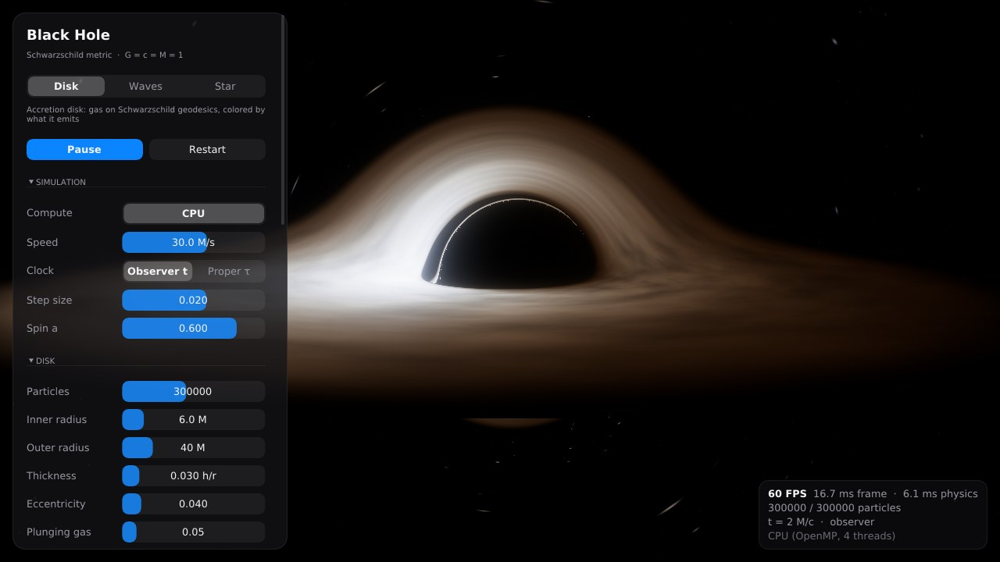

# UI: устройство и как его редизайнить

Интерфейс сделан на Dear ImGui, но разложен так, чтобы дизайн можно было
менять, не трогая симуляцию и рендер.

## Слои

| Файл | Что внутри | Когда трогать |
|---|---|---|
| `src/ui/Theme.hpp/.cpp` | **Токены дизайна**: цвета, радиусы, отступы, размеры шрифтов, ширина панели; загрузка шрифтов | Палитра, типографика, «воздух» |
| `src/ui/Widgets.hpp/.cpp` | Контролы: `ToggleSwitch` (iOS-тумблер), `SegmentedControl`, `SliderRow` (заливка как в Пункте управления), `BeginSection`, `ColormapBar`, кнопки | Внешний вид отдельных элементов |
| `src/ui/Ui.cpp` | Раскладка: какие секции, в каком порядке, HUD | Структура экранов |
| `src/ui/Ui.hpp` | Контракт: `UiContext` (что UI видит) и `UiActions` (что UI просит сделать) | Новые действия/данные |

Правила, которые держат слои раздельными:

- UI не вызывает OpenGL и не трогает частицы. Структурные вещи (сменить
  сценарий, перезапустить, скриншот) он возвращает через `UiActions`.
- Параметры сценариев UI рисует **обобщённо** по списку `ParamDesc`
  (`src/sim/Parameters.hpp`): подпись, диапазон, формат, подсказка, «нужен ли
  перезапуск». Новый параметр в сценарии появляется в UI сам.
- Все цвета и размеры берутся из `tokens()`. Захардкоженных цветов в панелях нет.
- Анимации (тумблеры, пилюля сегмента, заливка слайдера) — экспоненциальное
  сглаживание в `animate()` в `Widgets.cpp`.

## Секции панели (сейчас)

- **Шапка:** сценарий (Disk / Waves / Star), Play/Pause, Restart.
- **Simulation:** Compute (CPU / GPU · CUDA), скорость, часы (Observer t / Proper τ), шаг, спин a.
- **Параметры сценария:** строятся автоматически из `ParamDesc`.
- **Appearance:** Physical / Data, цветовая карта и диапазон, размер точек, яркость.
- **Ray tracing:** линзирование, «Light from» (Disk / Particles / Both), параметры диска и объёма, шаг лучей.
- **Image, Camera, Guides** (свёрнуты по умолчанию), снизу — скриншот и подсказки по клавишам.
- **HUD** справа внизу: FPS, время физики, число частиц, время симуляции, бэкенд.

## Шрифты

`Theme.cpp` ищет шрифты по порядку: `assets/fonts/Inter-Regular.ttf` и
`Inter-SemiBold.ttf` (рядом с рабочей папкой), затем Segoe UI (Windows),
затем DejaVu (Linux). Чтобы поставить свой шрифт, положите TTF в
`assets/fonts/`. Нужен именно TTF: OTF с CFF-контурами ImGui не читает.
Диапазоны глифов: латиница, греческий, кириллица, математические символы.

## Что хорошо бы сделать в редизайне

- Иконки (например, Lucide/SF-подобный шрифт иконок, слитый в `loadFont`).
- Нижняя «транспортная» панель: play/pause, скорость, время — вместо кнопок в боковой панели.
- Легенда цвета прямо в кадре (сейчас она в панели).
- Пресеты камеры и «режим презентации» (плавные облёты для видео).
- Светлая тема — достаточно второго набора `ThemeTokens`.
